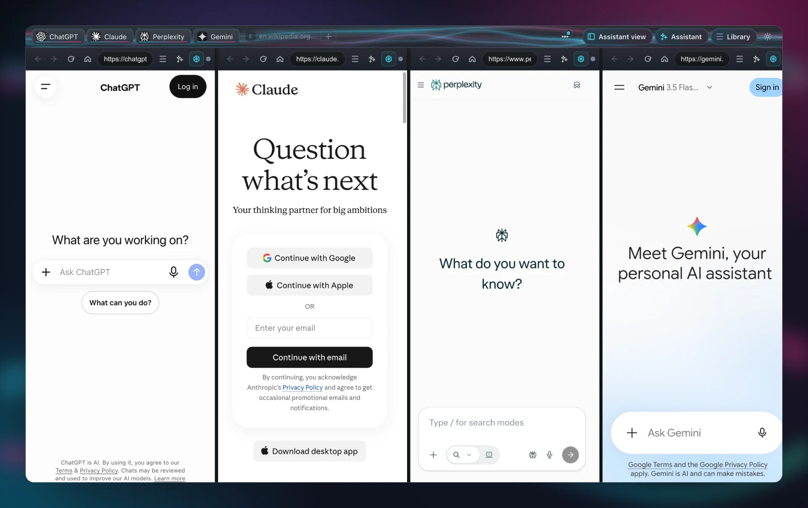
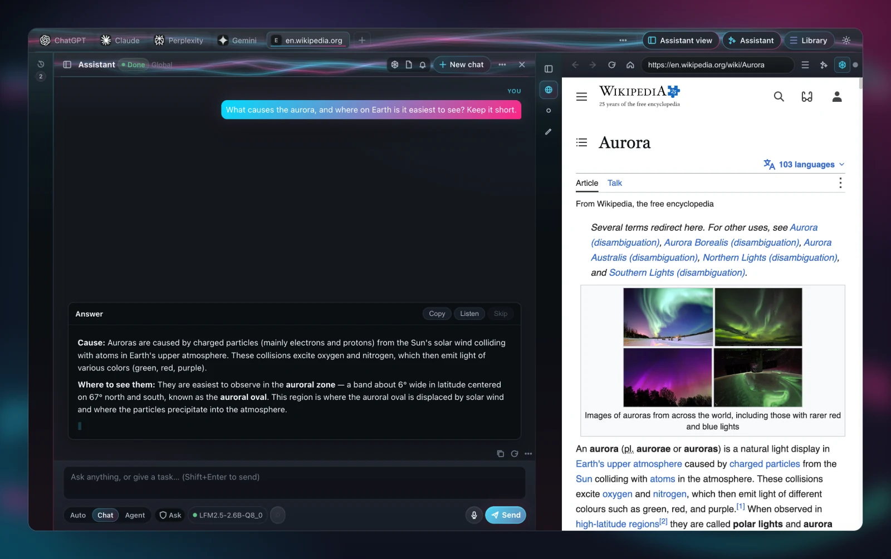
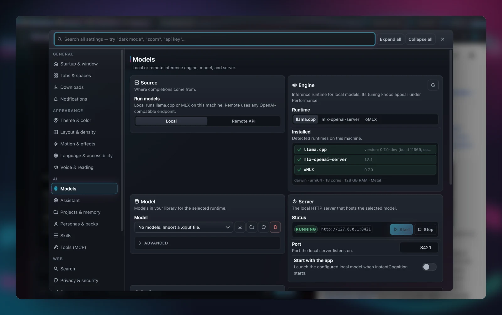
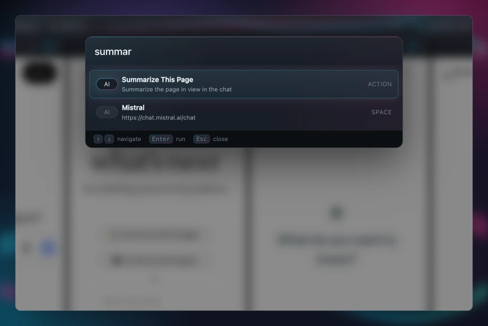
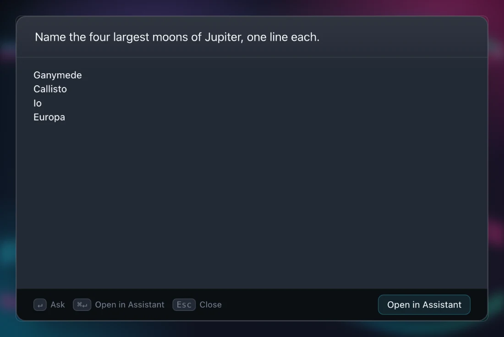

<div align="center">

<a href="https://github.com/daemon-summoner/InstantCognition/releases"></a>

<br>

<a href="https://github.com/daemon-summoner/InstantCognition/releases"></a>


<a href="LICENSE"></a>

<br>

**[Download](#download)** &nbsp;·&nbsp; **[Spaces](#spaces)** &nbsp;·&nbsp; **[Assistant](#assistant)** &nbsp;·&nbsp; **[Local models](#models)** &nbsp;·&nbsp; **[Agent](#agent)** &nbsp;·&nbsp; **[Shortcuts](#keyboard)** &nbsp;·&nbsp; **[Build from source](#developers)**

</div>

<br>

<p align="center">
  
</p>

<p align="center">
  Press a hotkey and InstantCognition is there: ChatGPT, Claude, Gemini and Perplexity side by side,<br>
  a model running privately on your own hardware, and an agent that can drive the page for you.<br>
  Press it again and it's gone. <b>No account. No telemetry. Free and open source.</b>
</p>

<p align="center">
  
  
  
</p>

<p align="center"></p>

<a id="spaces"></a>
<p align="center"></p>

Every AI service you use lives in its own **space**, with its own login and session. Put them side by side and ask the same question everywhere at once.

- **Up to 50 spaces.** Any AI service or website, each in its own session.
- **Five layouts.** Single, side by side, grid, stacked and two-row, with splits you can drag to resize.
- **Multi-space view** (<kbd>Cmd/Ctrl</kbd> <kbd>M</kbd>) shows several spaces at once. Click a tab to show or hide it.
- **Ask All Spaces** (<kbd>Cmd/Ctrl</kbd> <kbd>Shift</kbd> <kbd>B</kbd>) sends one question to every open assistant and lines the answers up for comparison.
- **A toolbar that's alive.** Aurora, nebula and flowline scenes drift across the top bar. Tone them down or turn them off in **Settings → Motion & effects**.

<p align="center"></p>

<a id="assistant"></a>
<p align="center"></p>

<p align="center">
  
  <br><sub>A real answer from LFM2.5 2.6B, running locally through the bundled llama.cpp engine.</sub>
</p>

- **Assistant view** (<kbd>Cmd/Ctrl</kbd> <kbd>E</kbd>) flips the whole window into a focused chat, with the page you were on docked beside it.
- **Page copilot.** Ask about the page in front of you: summarize it, pull out data, or explain the hard part.
- **Sessions that branch.** Every conversation is a tree you can fork, rewind and pick back up. Background sessions run side by side and report to an inbox when they finish.
- **Projects.** Upload files and images, `@`-mention them in the composer, and keep a set always in context.
- **Personas, skills and memory.** A user-memory layer carries context from one session to the next.
- **Artifacts.** HTML pages, Markdown, Mermaid diagrams, SVG and code render live beside the chat, versioned per session, in a locked-down sandboxed frame.

<p align="center"></p>

<a id="models"></a>
<p align="center"></p>

<p align="center">
  
</p>

Run models on your own hardware, so your questions never leave your machine. Or plug in any cloud endpoint you like.

- **llama.cpp, ready out of the box.** A `llama-server` binary ships for every platform, so there's nothing extra to install.
- **MLX on Apple silicon** through `mlx-openai-server` or oMLX, and **vLLM** on NVIDIA GPUs (Linux, or Windows through WSL2) with guided setup.
- **Model Hub.** Search Hugging Face, download GGUF and MLX models, and manage what's on disk.
- **Engine discovery** finds the runtimes you already have and remembers them.
- **Any OpenAI-compatible endpoint** works as a remote backend.

<p align="center"></p>

<a id="agent"></a>
<p align="center"></p>

Give the agent a goal and it works the live page the way you would: it observes, plans, then acts.

- **Real browser tools.** It can navigate, click, type, read, manage tabs, take screenshots, search, check your history and call MCP servers.
- **You stay in charge.** Every session runs in one of four modes: **Ask**, **Auto-edit**, **Plan** or **Bypass**. Risky actions stop at an approval card first, and deny rules always win. A domain allow and block list controls where the agent can go.
- **Research Report mode** opens its sources as live panes and cites them inline.
- **Files and shell, fenced in.** File and shell tools only reach the workspace folders you add. Each turn's file changes are snapshotted, so you can rewind them.
- **Skills and subagents.** Teach it a workflow as a skill, or record yourself doing a task in the browser and replay it as one. Big jobs can split across subagents.
- **Routines** re-run a saved task on an interval or a daily schedule.
- **Private tabs are off-limits.** The agent never sees or touches them.

<p align="center"></p>

<a id="speed"></a>
<p align="center"></p>

<p align="center">
  
  
</p>

- **Global hotkey.** <kbd>Alt</kbd> <kbd>Space</kbd> on macOS, <kbd>Ctrl</kbd> <kbd>Space</kbd> on Windows and Linux, shows and hides the window from any app.
- **Quick launcher** (<kbd>Alt</kbd> <kbd>Shift</kbd> <kbd>Space</kbd>). A floating prompt over whatever you're doing. The answer streams in right there, and <kbd>Cmd/Ctrl</kbd> <kbd>Enter</kbd> moves the conversation into the assistant.
- **Command palette** (<kbd>Cmd/Ctrl</kbd> <kbd>K</kbd>) reaches every action, space and AI workflow by name.
- **Voice input** through a bundled Moonshine speech model that runs on your machine.
- **Your keys.** Every shortcut can be remapped in **Settings → Shortcuts**.

<p align="center"></p>

<a id="browser"></a>
<p align="center"></p>

- **Library** (<kbd>Cmd/Ctrl</kbd> <kbd>Shift</kbd> <kbd>Y</kbd>). History, bookmarks and downloads in one place, plus **Ask your browsing**: ask in plain language about pages you've read and saved, with the search running on your machine.
- **Chrome extensions.** Install them from the Web Store, a `.crx`, a `.zip` or an unpacked folder.
- **Built-in protection.** An ad blocker, HTTPS-only mode, third-party cookie blocking, Do Not Track and Global Privacy Control, and clearing cookies on quit.
- **Saved passwords.** It offers to save a login after you sign in, encrypts it with your system keychain, and fills it from the page's right-click menu.
- **Reader view** with read-aloud, private tabs, permission prompts, custom DNS and certificate handling.
- **Locked down by design.** The app's own interface runs sandboxed, with no Node access, behind a strict content security policy.

<p align="center"></p>

<a id="download"></a>
<p align="center"></p>

<p align="center">
  <a href="https://github.com/daemon-summoner/InstantCognition/releases"></a>
  <a href="https://github.com/daemon-summoner/InstantCognition/releases"></a>
  <a href="https://github.com/daemon-summoner/InstantCognition/releases"></a>
</p>

| Platform | Download | Updates itself |
|---|---|---|
| Windows x64 / arm64 | `Setup.exe` installer, or portable `.exe` | installer only |
| macOS arm64 / x64 | `.dmg` | yes, once the build is signed |
| Linux x64 / arm64 | `AppImage` | yes |

Updates download in the background and install the next time you quit, and a toast offers to restart right away. Turn this off in **Settings → Updates**, where **Check now** runs a manual check. A build that can't replace itself (the Windows portable exe, an unsigned macOS app, a dev run) tells you about the new version and links its release page instead.

**macOS:** a release built without signing secrets is ad-hoc signed and not notarized, so Gatekeeper blocks the first launch. Clear the quarantine flag once:

```bash
xattr -dr com.apple.quarantine /Applications/InstantCognition.app
```

**Windows:** SmartScreen warns about unsigned builds. Choose *More info*, then *Run anyway*.

### Set up a model

Open **Settings → Models**. Choose **Local** or **Remote API**. For local, pick a runtime (llama.cpp, MLX or vLLM, depending on your hardware), then import a model you already have or download one from the Model Hub. A remote OpenAI-compatible endpoint goes on the same page.

<p align="center"></p>

<a id="keyboard"></a>
<p align="center"></p>

| Shortcut | What it does |
|---|---|
| <kbd>Alt</kbd> <kbd>Space</kbd> (macOS) · <kbd>Ctrl</kbd> <kbd>Space</kbd> | Show or hide the window |
| <kbd>Alt</kbd> <kbd>Shift</kbd> <kbd>Space</kbd> | Quick launcher |
| <kbd>Cmd/Ctrl</kbd> <kbd>K</kbd> | Command palette |
| <kbd>Cmd/Ctrl</kbd> <kbd>E</kbd> | Flip between the assistant view and the browser |
| <kbd>Cmd/Ctrl</kbd> <kbd>Shift</kbd> <kbd>A</kbd> | Assistant panel |
| <kbd>Cmd/Ctrl</kbd> <kbd>Shift</kbd> <kbd>B</kbd> | Ask all spaces |
| <kbd>Cmd/Ctrl</kbd> <kbd>M</kbd> | Multi-space view |
| <kbd>Cmd/Ctrl</kbd> <kbd>T</kbd> | New tab |
| <kbd>Cmd/Ctrl</kbd> <kbd>W</kbd> | Close tab |
| <kbd>Cmd/Ctrl</kbd> <kbd>L</kbd> | Focus the address bar |
| <kbd>Cmd/Ctrl</kbd> <kbd>F</kbd> | Find in page |
| <kbd>Cmd/Ctrl</kbd> <kbd>Shift</kbd> <kbd>Y</kbd> | Library: history, bookmarks, downloads |
| <kbd>Cmd/Ctrl</kbd> <kbd>Shift</kbd> <kbd>E</kbd> | Extensions |
| <kbd>Cmd/Ctrl</kbd> <kbd>Shift</kbd> <kbd>N</kbd> | Notifications |
| <kbd>Cmd/Ctrl</kbd> <kbd>,</kbd> | Settings |

Every one of these can be remapped in **Settings → Shortcuts**. The File menu adds <kbd>Cmd/Ctrl</kbd> <kbd>Shift</kbd> <kbd>T</kbd> (reopen closed tab), <kbd>Cmd/Ctrl</kbd> <kbd>Alt</kbd> <kbd>P</kbd> (new private tab) and <kbd>Cmd/Ctrl</kbd> <kbd>P</kbd> (print). These work even while a page has focus.

<p align="center"></p>

<a id="developers"></a>
## Build from source

<details>
<summary><b>Requirements, scripts, releases and architecture</b></summary>

<br>

### Requirements

Node.js 22.22.2 or newer.

```bash
npm ci
npm start
```

### Scripts

```bash
npm start            # run the app
npm test             # full Jest suite
npm run lint         # ESLint
npm run typecheck    # tsc --noEmit over JSDoc-annotated JS
npm run verify       # typecheck + lint + tests
npm run fix          # eslint --fix

npm run test:coverage    # coverage with per-directory thresholds
npm run test:e2e:app     # Playwright smoke against a real Electron launch
npm run test:smoke       # real-engine LLM smoke (downloads small models)

npm run build:install    # build a distributable for the current platform
```

The repo also carries four zero-argument scripts that wrap the above, so tooling doesn't have to know the package manager: `./build_install.sh` (install and build), `./run.sh` (run), `./verify.sh` (typecheck and lint) and `./test.sh` (test suite). Build output lands in `builds/`.

`build_install.sh` and the release workflow both install the newest patch of the Electron major in `package.json` before packaging, and both gate that on the launch smoke. A new Electron major is a `package.json` change. Set `ELECTRON_PIN=1` for a reproducible local build at the pinned version.

### Releases

A pushed `v*` tag builds Linux x64/arm64 AppImages on the self-hosted runners, macOS arm64/x64 on `macos-latest` and Windows x64/arm64 on `windows-latest` (`.github/workflows/release.yml`), then publishes them to one release that carries update artifacts, not source.

Signing is optional and turns on when the secrets exist:

| Secret | Effect |
|---|---|
| `MAC_CSC_LINK`, `MAC_CSC_KEY_PASSWORD` | Developer ID `.p12` (base64 or URL) signs the macOS app; without it the app is ad-hoc signed |
| `APPLE_API_KEY_P8`, `APPLE_API_KEY_ID`, `APPLE_API_ISSUER` | App Store Connect API key (the `.p8` contents) notarizes the signed macOS app |
| `WIN_CSC_LINK`, `WIN_CSC_KEY_PASSWORD` | Authenticode `.pfx` signs the Windows builds |
| `AZURE_CLIENT_SECRET`, `AZURE_TENANT_ID`, `AZURE_CLIENT_ID`, `AZURE_SIGN_ENDPOINT`, `AZURE_SIGN_ACCOUNT`, `AZURE_SIGN_PROFILE`, `AZURE_SIGN_PUBLISHER` | Azure Trusted Signing for Windows, used instead of a `.pfx` |

Once a signed Windows build has shipped, electron-updater rejects any update not signed by the same publisher. At that point set `"forceCodeSigning": true` under `build.win` (and `build.mac`), so an unsigned release fails in CI instead of stranding every installed copy.

### Architecture

```
main.js                  platform detection, single-instance lock
main/
  index.js               window creation and lifecycle
  App.js                 service orchestrator
  ipc/                   domain-split IPC handlers, registered by ipc/index.js
  services/              main-process singletons (config, LLM, agent, browsing…)
  agent/                 agent runtime, sessions, permissions, tools, skills
  launcher/              quick-launcher window and global hotkey
  utils/                 logger, error handler, crash recovery
renderer/
  renderer.js            bootstrap, config load, manager wiring
  core/AppState.js       observable state container
  ipc/ipcBridge.js       centralized renderer-side IPC
  managers/              space, navigation, layout, find bar, browser view
  layouts/               layout strategies
  components/            chrome, tab bar, assistant, settings, palette…
  styles/                design tokens plus light and dark themes
shared/                  config defaults, paths and LLM defaults
tests/                   unit, integration and e2e suites
```

The main process owns services and IPC. The renderer owns managers and components, runs sandboxed with no Node access, and reaches main only through the preload bridge that `ipcBridge` wraps. State changes flow through `AppState` rather than globals.

### Testing

The suite covers unit tests (main, renderer, shared), integration tests and e2e projects; `tests/README.md` maps the tree. `tests/e2e/appLaunch.test.js` boots a real Electron process through Playwright and is gated behind `RUN_APP_SMOKE=1`.

Contributions are welcome. See [CONTRIBUTING.md](CONTRIBUTING.md).

</details>

## License

MIT. See [LICENSE](LICENSE). Third-party components and their licenses are listed in [THIRD_PARTY_LICENSES.md](THIRD_PARTY_LICENSES.md).

<br>

<p align="center"></p>
